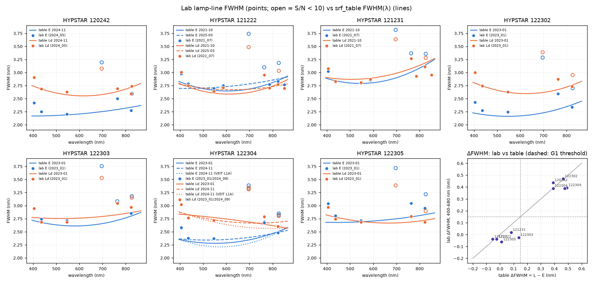
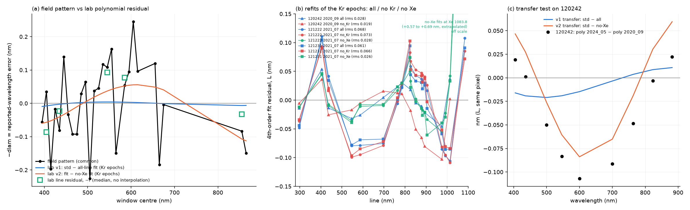

# Spectral wiggles in WATERHYPERNET ρw — interim report

**J. Xavier Prochaska (UC Santa Cruz) · 18 October 2026** (updated from the
15 October version)

*For the HYPERNETS team.  This covers the work since our note of 28 September
2026, done on Kevin's VEIT sample, the Release 2 L2 archive, simulations and,
since 17 October, Joel's laboratory wavelength-calibration data.  The
requested L1A data have not yet arrived; everything that depends on them is
marked provisional.*

---

## 1. Summary

- **The wiggles are real, and the main cause on some instruments is not the
  one we started from.**  On three of the seven HYPSTARs we examined (122302,
  122304, 120242), the irradiance channel E sees the solar lines through a
  spectral response function (SRF) about **0.5 nm narrower** than the radiance
  channel L.  No interpolation of E onto the L grid can remove that mismatch.
  On the other four (121222, 121231, 122303, 122305), E and L agree to within
  0.06 nm at 450 nm.
- **Joel's laboratory data confirm the two classes, instrument by
  instrument.**
  - The lamp-line FWHM of L minus E is +0.39 to +0.47 nm on the three
    narrow-E units, and −0.06 to +0.02 nm on the other four.
  - 122303, which we had as borderline, is in the E ≈ L group.  Our L2 fit
    with its own E grid gives 0.17 nm, so we follow the lab there until the
    L1A shows otherwise.
  - The lab also settles the wavelength scale: it is **air**.
- **On the narrow-E units the E SRF is flat-topped** (super-Gaussian,
  exponent 2.5-2.9), while L is Gaussian on every instrument.
  - This costs the `srf` correction: in simulation a Gaussian correction keeps
    only 49-63 % of its gain when the true E is super-Gaussian, and 100 % when
    it knows the shape.
  - On the VEIT sample the lab shape improves the solar lines further but
    makes O₂-A worse, which we do not yet understand.  We have not made it the
    default.
- **The common 0.12 nm window pattern is only partly explained by the lab
  polynomials.**
  - The ±0.09 nm common residual of the lab wavelength polynomials is an
    artefact of a 4th-order fit that includes the Xe lines (without them the
    residual falls from ~0.07 to ~0.03 nm rms).
  - It explains a smooth 2.5-21 % of the pattern's variance.  About 80 %,
    the ±0.2 nm window-to-window structure, remains unexplained.
- **A one-symbol change to eq. (14) of Ruddick et al. (2023) fixes it.**
  Evaluate the model irradiance with the **L** SRF in the numerator (the
  `srf` method).  In simulation it removes ~100 % of the line-region error in
  ρw'' on a narrow-E instrument, where eq. (14) removes none.  On the real
  VEIT sample it cuts the line structure in Ld/Ed by ~4× at Ca H/K.
- **The code is ready to drop in.**  A `punpy` measurement function for
  `hypernets_processor` uses `srf` where E is ≥ 0.15 nm narrower than L, and
  linear interpolation elsewhere.  Left unwired, it reproduces today's linear
  interpolation exactly.
- **What we need from you** (Section 5): the L1A data and calibration files
  from our request, a few answers about the lab data and the processor's
  wavelength epochs, hardware and processor facts, and RBINS's view on
  integrating the snippet.  Thank you, Joel, for the lab data.

## 2. Goals

Kevin's hypothesis (Ruddick et al. 2023) is that ρw = π Lw / Ed acquires
spurious structure at the Fraunhofer and telluric lines because the processor
linearly interpolates E onto the L wavelength grid.  That structure dominates
ρw'', the quantity that pigment-detection algorithms use.  We set out to:

1. **diagnose** the wiggles: measure the E and L SRFs and wavelength scales
   from the solar lines themselves, and test two hypotheses:
   - **H1:** grid offset + linear interpolation (Kevin's);
   - **H2:** an E-vs-L SRF-width mismatch (ours, from the VEIT sample);
2. **predict**, with a simulation where the truth is known, which correction
   removes which wiggle, and what it does to real spectral features;
3. **deliver** a tested correction, with uncertainties in the processor's
   conventions, as a drop-in for `hypernets_processor`;
4. **verify** it on real sequences across sites and instruments, and write a
   technical note.

The plan has four phases with explicit gates (G0-G3); Phases 1 and 2 are done.

## 3. Work to date

### 3.1 Phase 0: what the data say (VEIT sample and the Release 2 archive)

We fit Gaussian SRFs against the TSIS-1 solar spectrum (HSRS) in 10 nm
windows, separately for E, Ld and Lu.  On the VEIT sample (HYPSTAR 122304)
E is ~2.2-2.4 nm wide and Ld/Lu ~2.6-2.9 nm (Figure 1).  The wavelength scale
is air, within 0.1 nm.

*Figure 1.  VEIT 2026-06-04, HYPSTAR 122304.  Top: SRF FWHM of E, Ld and Lu
from template fits to TSIS-1 HSRS.  Middle: L − E, ~0.5 nm in the blue.
Bottom: centroid offsets against HSRS in air (the dotted line is what a
vacuum scale would give).*

Repeating this on the 224 sequences of our data request, read from their
Release 2 L2B files, gives two instrument classes (Figure 2, Table 1).  The
SRFs are stable to 0.02-0.06 nm within each instrument and calibration
period, across SZA 21-74°, seasons, sites and recalibration.  These fits now
pass E through each instrument's own E wavelength grid, which the lab data
gave us (§3.4); before 18 October we had to use 122304's grid as a stand-in.
That moved the E widths by at most 0.055 nm.

*Figure 2.  Release 2 L2B, 224 sequences: SRF FWHM at 450 and 600 nm by
instrument and calibration.  E (blue) is ~0.5 nm narrower than Ld (orange) on
120242, 122302 and 122304.*

**Table 1.  The two instrument classes** (18 October; the 15 October values
in brackets where they moved).

- ΔFWHM = FWHM_Ld − FWHM_E, median over 400-680 nm, from L2, with each
  instrument's own E grid.  It uses the Gaussian-equivalent E width (§3.4).
- We had thought E from L2 reads 0.06-0.09 nm too wide.  We have withdrawn
  that: the lamp lines show no such bias (§3.4).

| instrument | site(s) | ΔFWHM (nm) | class | E SRF shape (lab) | method we would ship |
|---|---|---:|---|---|---|
| 122302 | BEFR, THFR | 0.44 (0.46) | narrow-E | super-Gaussian, p 2.93 | `srf` |
| 122304 | VEIT | 0.39-0.49 | narrow-E | super-Gaussian, p 2.76-2.80 | `srf` |
| 120242 | GAIT | 0.35 (0.39) | narrow-E | super-Gaussian, p 2.53 | `srf` |
| 122303 | MAFR | 0.17 (0.14) | E ≈ L (borderline before) | Gaussian | `linear`, set from the lab (lab ΔFWHM −0.02) |
| 121231 | MAFR | 0.03 (0.08) | E ≈ L | Gaussian | `linear` |
| 122305 | VEIT | 0.03 (0.01) | E ≈ L | Gaussian | `linear` |
| 121222 | GAIT | −0.06 to −0.05 (−0.05 to −0.03) | E ≈ L | Gaussian | `linear` |

**ρw wiggles follow the class** (Figure 3).  At the lines, the ρw residual on
narrow-E instruments is 2-3× that of E ≈ L instruments at Ca H/K and the
G band, at about the size H2 predicts.  The excess is absent at Na D, where H2
is small.  The two same-site pairs show it too: VEIT 122304 vs 122305, and
GAIT 120242 vs 121222.  The E ≈ L instruments keep a smaller line residual of
0.5-2 % that H2 does not explain.

*Figure 3.  Release 2, 224 sequences: the ρw relative residual within ±5 nm
of the lines, by instrument (left), and against each sequence's own H2
prediction (right).*

### 3.2 Phase 1: a twin experiment

We built synthetic HYPSTAR scenes where the truth is known:

- a 0.01 nm irradiance (TSIS-1 HSRS × HITRAN O₂/H₂O × O₃) multiplied by
  smooth OSOAA radiative-transfer fields;
- 25 sky/water states, with chlorophyll fluorescence and water Raman as real
  features a correction must not erase;
- observed with the measured SRFs on the real pixel grids.

We then scored the three interpolation methods by the error in ρw'' near ten
solar and telluric lines.

*Figure 4.  Twin experiment, HYPSTAR 122304 SRFs: ρw'' at Ca H/K, Hα and
O₂-A for the truth and three methods.  Top: grid offset plus SRF mismatch.
Bottom: grid offset only.*

**Table 2.  Twin results (median over 25 scenes, h = 1 nm).**

| | linear | eq. 14 (`ruddick2023`) | `srf` |
|---|---|---|---|
| narrow-E (122304), offset + mismatch: reduction of the line-region ρw'' error vs linear | — | 0 % (−6 %) | **~100 %** |
| grid offset only (H1): its error relative to the mismatch error | 4 % | removes 99 % | removes 99 % |
| E ≈ L (122305): linear's error vs the true line structure | below it | 2.3× *worse* than linear | 99.5 %, but fragile |

- **H1 is small on these well-sampled spectra; H2 dominates.**
- **Gate G1 passed for narrow-E instruments.**  `srf` meets the > 80 % target,
  and eq. 14 alone does not.
- **What `srf` needs:**
  - the E wavelength scale known to ≤ 0.05 nm relative to the model, and the
    SRF widths to ≲ 0.07-0.1 nm;
  - the model irradiance's atmosphere matters little (≥ 98 % for SZA ± 10°,
    water vapour × 0.5-3).
- **No method damages the fluorescence or Raman features.**  `srf` restores
  them exactly, while linear distorts their ρw'' by 20-45 %.
- **Prediction for real data:** a 60-75 % reduction of the observable
  line-region excess per sequence at ΔFWHM 0.5 nm, and little below 0.1 nm
  (Figure 5).

*Figure 5.  The expected reduction against ΔFWHM.  (a) the twin metric; (b)
the observable excess that can be measured on real data without a truth;
(c) per line, with VEIT-level noise.*

### 3.3 Phase 2: code and a first check on real data

**Deliverables** (all in the `hypernet` package, now 156 tests):

- `interpolate_ed_to_l`: linear, eq. 14 and `srf` on one code path.  With a
  flat model it is exactly `np.interp`; with equal SRFs it is exactly eq. 14.
- SRF self-calibration from a single spectrum, and a wavelength-scale fit
  (shift + stretch).
- A cached model irradiance per SZA bin.
- A per-instrument SRF table, provisional until the L1A delivery.  Since 18
  October it carries each instrument's E SRF shape (Gaussian, or
  super-Gaussian with the lab exponent), and the convolution honours it.
- Uncertainty propagation with `punpy` into the processor's three relative
  components.
- **`InterpolationWavSRF`**, a drop-in for `InterpolationWavLinear`
  (Section 4).

**On the VEIT sample** (Figure 6):

- linear interpolation reproduces your L1C irradiance to a median of
  1.3 × 10⁻⁵;
- `srf` reduces the line structure in Ld/Ed_L from 2.45× to 1.60× the
  away-from-lines level, and at Ca H/K from 0.034 to 0.009 rms;
- eq. 14 makes it slightly worse, as the twin predicted;
- the new uncertainty terms (SRF, wavelength scale, model) are ~0.04 %,
  below the 0.13 % measurement noise except inside the deep gas bands.

*Figure 6.  VEIT sample: Ld / Ed_L for the three methods, zooms with ±1σ
bands, and the uncertainty components of the `srf` result.*

**Robustness** (Figure 7):

- the gain survives a pseudo-Voigt SRF (97-98 %) and an asymmetric one
  (80-90 %);
- with the flat-topped shapes our Phase 0 fits allow, it drops to 66-84 %;
- with the shape the lab now shows (E super-Gaussian with p 2.8, L
  Gaussian), a Gaussian correction keeps 49-63 % (27-45 % if E is also
  0.2 nm narrower), and a correction that knows the shape keeps 100 %.
  This is the main residual risk, and the reason the table now carries the
  shape (§3.4).

*Figure 7.  (a) The `srf` reduction when the true SRF is not Gaussian but the
correction is.  (b) The per-window wavelength pattern produced by SRF shape,
compared with the pattern seen on every real HYPSTAR (black).*

**Two findings we cannot yet explain:**

- **A 0.12 nm rms per-window wavelength pattern, the same on all seven
  instruments and in both channels** (0.13 nm in the 15 October version,
  quoted over the per-instrument patterns).
  - It is not SRF shape, and not the solar reference (HSRS agrees with
    Kurucz 2005 to < 0.01 nm in 24 of 27 windows).
  - It is not our old stand-in E grid: the own grids move it by
    ≤ 0.0025 nm.
  - Weak telluric lines explain part of it in simulation, but not on the
    real data.
  - The lab polynomials explain only a smooth part of it (§3.4).
  - We remove it empirically for now.
- **The wavelength scale itself has a stretch.**  After removing that
  pattern, E's scale error reaches ~0.1 nm at the ends of the spectrum,
  above the 0.05 nm `srf` needs.  The code corrects it per sequence (or per
  calibration period).

### 3.4 The laboratory wavelength calibration (Joel's data, 17 October)

Joel sent the lab wavelength calibration of all seven instruments, 13 lab
epochs in all.  Each epoch holds:
- the FWHM of E and L at the Hg/Ar/Xe (and Kr) lamp lines;
- the 4th-order pixel → λ polynomials;
- the lamp spectra seen by both channels.

We read them with a new module (`hypernet/labcal.py`).  The coefficients and
our refits of every lamp line are committed tables.

**The lab confirms the field classes** (Figure 8, Table 3).
- L − E is +0.39 to +0.47 nm on 120242, 122302 and 122304, and −0.06 to
  +0.02 nm on the other four.
- Our field FWHM(λ) curves agree with the lamp widths to within ~0.1 nm,
  channel by channel.
- 122303 is clearly E ≈ L in the lab (−0.02 nm).  With its own E grid, our
  L2 fit gives 0.17 nm, just above the 0.15 nm threshold.  The table
  follows the lab for 122303, with a note, until its L1A E settles it.

*Figure 8.  Lab lamp-line FWHM (points; open = S/N < 10, which reads wide)
against our field SRF table FWHM(λ) (lines), E in blue and Ld in orange.  The
last panel: ΔFWHM lab against field, with the 0.15 nm threshold (dashed).*

**Table 3.  Lab vs field, per instrument.**

- ΔFWHM is the median over the 400-680 nm lines (lab) or 400-680 nm (field),
  Gaussian-equivalent widths.
- The processor epoch is the lab polynomial the Release 2 grids come from.
  "verified" means a processor grid reproduces it exactly: every L grid, and
  only 122304's E grid.  "inferred" means the E epoch is assumed to be the L
  one.

| instrument | ΔFWHM lab | ΔFWHM field | E shape p (lab) | processor epoch | L / E |
|---|---:|---:|---|---|---|
| 120242 | +0.44 | 0.35 | 2.53 | 2024_05 (pixel window of 2020_09) | verified / inferred |
| 121222 | −0.04 | −0.06 / −0.05 | Gaussian | 2021_07 (also after the 2025-03 recalibration) | verified / inferred |
| 121231 | +0.02 | 0.03 | Gaussian | 2021_07 | verified / inferred |
| 122302 | +0.47 | 0.44 | 2.93 | 2023_01 | verified / inferred |
| 122303 | −0.02 | 0.17 | Gaussian | 2023_01 | verified / inferred |
| 122304 | +0.39 / +0.39 | 0.49 / 0.39 | 2.76 / 2.80 | 2023_01 (also after the 2024-11 recalibration) | verified / verified |
| 122305 | −0.06 | 0.03 | Gaussian | 2023_01 | verified / inferred |

**What else the lab data show:**

- **The scale is air.**  All 19 reference lines are NIST air wavelengths.
  This answers our earlier question.
- **The processor's grids are the lab polynomials**, cropped to
  350 ≤ λ < 1100 nm.  They reproduce the VEIT L1A grids and every Release 2
  L grid to ≤ 4 × 10⁻⁵ nm.
  - There is one lab epoch per instrument, not one per calibration period.
    122304 keeps its 2023_01 wavelengths after the November 2024
    recalibration.
  - 120242's pixel window is the one its first (2020_09) polynomial selects,
    while its wavelengths are from 2024_05.
- **A flat-topped E.**  On the three narrow-E units the E lamp lines are
  fitted far better by a super-Gaussian (exponent 2.5-2.9) than by a
  Gaussian; L is Gaussian everywhere.
  - The SRF table now carries this shape for E.  Its FWHM(λ) is refitted on
    the field data with the lab exponent held fixed.
  - On the VEIT sample the shaped correction reduces Ca H/K, the G band,
    Mg b and Hα further than the Gaussian `srf` (e.g. G band 0.0088 →
    0.0075).  But it makes O₂-A worse (0.0076 → 0.0198).  The field fits
    prefer an exponent near 2.5, against the lab's 2.8.
  - We have not decided whether the shaped E should be the default.
- **The "E from L2 reads wide" bias is withdrawn.**  Measured against the
  lamp, the L2 E widths are no wider than the L widths, once the lab's FWHM
  definition is allowed for.
- **The common window pattern** (Figure 9).
  - The lab polynomials miss the same lines by the same amounts on every
    instrument (+0.09 nm at Hg 404.7, −0.09 nm at Hg 546.1).
  - This comes from fitting one 4th-order polynomial through lines spanning
    297-1084 nm that include the Xe NIR lines.  Without the Xe lines the
    residual falls from ~0.07 to ~0.03 nm rms, as on 120242's 2020_09
    epoch, which was calibrated without Xe.
  - Because the processor uses these polynomials, the residual is a real
    error of the Release 2 grids.  But it is smooth: it accounts for
    2.5-21 % of the field pattern's variance.
  - It does not account for the ±0.2 nm window-to-window structure, nor for
    the sign at 405 nm.  About 80 % of the pattern remains unexplained.
  - Most of 120242's apparent 2020 → 2022 "drift" of its wavelength
    polynomial (~0.09 nm) is this line-set change, not the instrument
    moving.

*Figure 9.  (a) The common field window pattern against the lab polynomial
residual (two estimates between the lines, and the lab line residuals
themselves).  (b) Refits of the lab polynomials with all lines, without Kr
and without Xe.  (c) 120242: the change of its polynomial from 2020_09 to
2024_05 against the line-set prediction.*

- **Native-grid E from L2.**  L1C/L2 store E interpolated onto the L grid,
  linearly, so with the right E grid the native E can be recovered by
  inverting that interpolation.
  - On VEIT this reproduces the L1A E to 1.5 × 10⁻⁵ over 400-900 nm.  The
    widths fitted on the recovered E equal those of our L2 route to
    ≤ 0.011 nm.
  - But the inversion cannot tell us whether the E grid is right.  A grid
    0.05 nm off gives an equally clean-looking spectrum, wrong by ~1 × 10⁻³
    and by 24-36 % in its second differences, which only the L1A truth
    reveals.
  - So the E epoch of the six instruments other than 122304 is not testable
    from L2.  Only grossly wrong grids are excluded.

## 4. What comes next

**A provisional gate G0** (Release 2 L2 plus the lab data, no L1A;
`claude_prompts/wiggles/gate_G0.md`) passes, with conditions:

- **(a) E-vs-L mismatch: pass, per instrument.**  It is needed on 120242,
  122302 and 122304; not on the other four.
- **(b) Stability: pass.**
  - Field spread ≤ 0.06 nm; recalibration jumps ≤ 0.03 nm; lab epochs
    within 0.12 nm.  All are well under 0.2 nm.
  - So the per-instrument SRF table is the default.
- **(c) Wavelength scale: triggered, and already handled.**
  - Centroid offsets are ≤ 0.1 nm, but the dispersion reaches 0.1-0.24 nm
    at the ends of 390-870 nm.
  - The per-sequence shift + stretch correction is that wavelength
    correction.

The SRF table is now validated against the lab.  Two decisions are pending
before Phase 3:

- **E shape.**  Do we use the lab's flat-topped E SRF by default, given the
  O₂-A result on VEIT, or keep Gaussian rows until the L1A E shapes exist?
- **The threshold.**  Do we confirm that the 0.15 nm threshold applies to
  the Gaussian-equivalent E width on super-Gaussian rows?

| step | what | needs |
|---|---|---|
| Phase 0b → final gate G0 | Refit E and L on L1A with per-pixel errors and per-scan data.  Confirm the instrument classes, the E SRF shape in sunlight and SRF stability.  Settle 122303.  Confirm the E grid (wavelength epoch) the processor used on the six instruments other than 122304, which the L2 data cannot test | **the L1A delivery** |
| SRF table | Rebuild it from L1A, replacing the provisional L2 rows | Phase 0b |
| Phase 3 → gate G3 | Apply the three methods to every requested sequence; compare the reduction of the line-region ρw'' excess with the Phase 1 prediction (60-75 % on narrow-E instruments); check that fluorescence and pure-water features are unchanged | L1A delivery, ancillary water vapour |
| Open items | The ~80 % of the common window pattern the lab polynomials do not explain; the O₂-A behaviour of the shaped E; the 936 nm water band (needs per-sequence water vapour); extending the model irradiance to 350-1100 nm | — |
| Technical note | Diagnosis, twin results, in-situ before/after, uncertainty budget; code hand-over | G3 |

## 5. What we need from the HYPERNETS team

1. **The L1A delivery in our request** (`docs/wiggles_data_request.csv`, sent
   28 September 2026).
   - **Products:** L1A_IRR, L1A_RAD, L1C_ALL and L2A_REF for the 150 primary
     sequences, with spares where a primary is unsuitable.
   - **Coverage:** five sites and seven instruments.  If 150 is too many, the
     three GAIT rows can go first.
   - **Calibration files:** `HYPERNETS_CAL_HYPSTAR_<id>_{RAD,IRR}_v2.3.nc`
     for the seven instruments, with both versions for 122304 and 121222.
     The `instrument_calibration_file_rad` attribute points to the IRR file
     in the sample, so we would welcome the RAD file names.

   Everything marked provisional above waits on this, including the final
   gate G0.  It is also the only way to check which E wavelengths the
   processor used on six of the seven instruments (§3.4).
2. **Laboratory slit-function and wavelength-calibration data: received.**
   Thank you, Joel.  They settled the E/L classes and the SRF shape, and
   explained part of the window pattern (§3.4).  A few questions about them:
   - **The processor's wavelength epoch after recalibration.**  Release 2
     still uses the 2023_01 polynomials for 122304 after its November 2024
     recalibration, and likewise for 122302.  The 2024_09 lab polynomials
     differ by 0.02-0.05 nm rms, and by up to 0.10 nm.  Is keeping the
     older wavelengths intentional?  Which E wavelengths does the processor
     use for each instrument?  From L2 we can check this only for 122304.
   - **A 2025 lab epoch for 121222.**  Is there one from its March 2025
     recalibration?  The zip has only the 2021_07 epochs.
   - **The `wl` column of `lamp_vnir.dat`.**  It looks like a fixed nominal
     grid per instrument, perhaps the factory one, and `deltawl` is measured
     against it.  Is that right?
   - **How the lamp illuminates the irradiance entrance optic.**  Into the
     diffuser, at what angle, and does it fill it?  In the lab the E profile
     is flat-topped (exponent ~2.8); our solar-line fits give ~2.2-2.5.  We
     would like to know whether sunlight and skylight fill the diffuser
     differently from the lamp.
   - **Which lines were fitted** for the wavelength polynomials.  We have
     assumed all the lines in `deltawl_vnir.dat`.
   - We have committed tables derived from these files (the polynomial
     coefficients and the lab FWHM at each line) to our repository, whose
     documentation is public.  Please tell us if you would rather they were
     not public.
3. **What differs in hardware between the narrow-E instruments (122302,
   122304, 120242) and the others.**  In the irradiance fore-optics, diffuser,
   fibre or slit configuration?  It is not instrument age; the serial numbers
   split both ways.
4. **Stray-light or out-of-band characterisation** of the HYPSTAR
   spectrometer, if any.  The lamp spectra already show a floor ≤ 3 × 10⁻⁴
   of a bright line, so ordinary stray light seems unlikely.  But something
   common to every unit is still our leading candidate for the ~80 % of the
   window pattern the lab polynomials do not explain.
5. **The processor:**
   - **The code version that produced Release 2.**  The public
     `hypernets_processor` (`main` = `9a12819a`, March 2026) is not current
     with it.  We wrote the snippet against that commit.
   - **Is `mcsteps = 0` intended for the water network?**  With it, no
     uncertainty propagates through the interpolation step, and the L1C
     `u_rel_*` irradiance values are all zero.
   - **`InterpolationWavClearSky`** is an eq.-14-style interpolator with a
     3 nm placeholder SRF.  As written it returns values on the irradiance
     pixels and never uses the radiance wavelengths.  Was it ever run on water
     data?
   - **Integrating `InterpolationWavSRF`.**  It needs one factory entry, the
     config value, and `system_id` and the acquisition date passed to its
     `setup` call (details in the module docstring).  Would RBINS be willing
     to wire and test it?
6. **A per-sequence water-vapour column** (e.g. the ancillary data the
   processor already retrieves), so the model irradiance can follow the 936 nm
   band.
7. **The wavelength scale: answered.**  It is air, as the lab reference
   lines show.
8. **A suggestion for the processor's wavelength calibration.**  The ±0.09 nm
   common residual of the lab polynomials comes from fitting one 4th-order
   polynomial through lines from 297 to 1084 nm, including the Xe lines.
   Fitting without the Xe lines, which brings the residual to ~0.03 nm over
   297-1014 nm, or using a more flexible pixel → λ model (a higher order or
   piecewise fit) would remove a smooth ~0.05-0.1 nm error from the Release
   2 grids.  We offer this as a suggestion only; we have not tested its
   effect on the processor.

---

*Code and tables: the `hypernet` repository (`hypernet/edinterp.py`,
`srfcal.py`, `srftable.py`, `emod.py`, `labcal.py`,
`snippets/interpolate_wav_srf.py`; the lab tables `hypernet/data/lab_*.csv`;
results in `hypernet/wiggles/`).  The full plan is
`docs/wiggles_planning.md`.*
