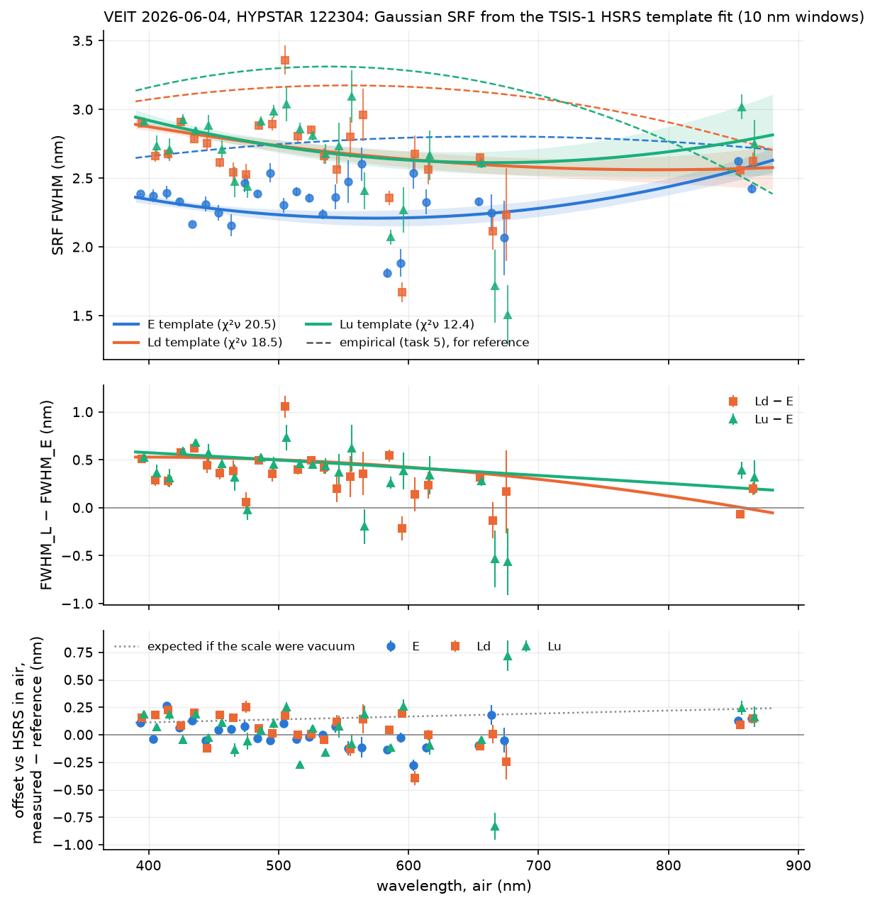
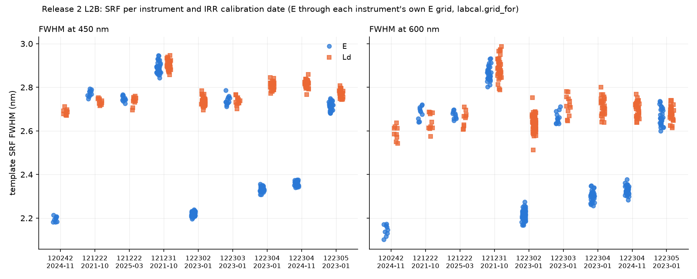
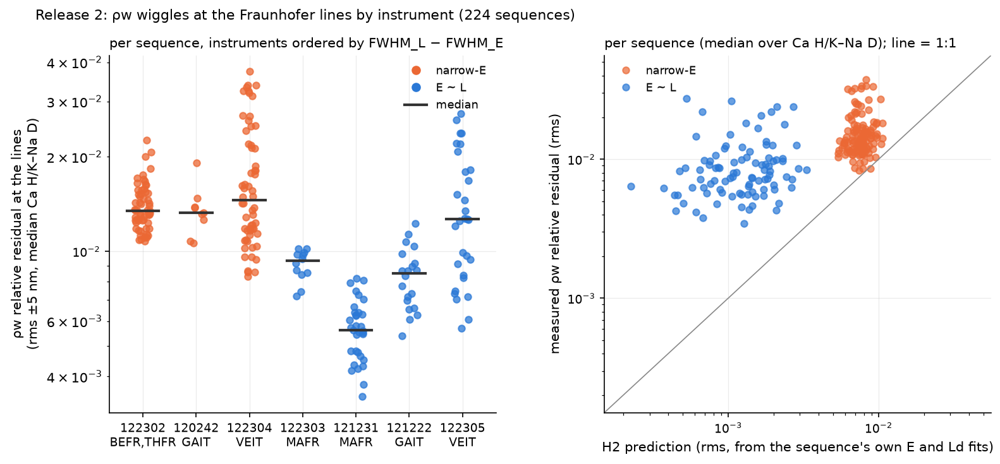
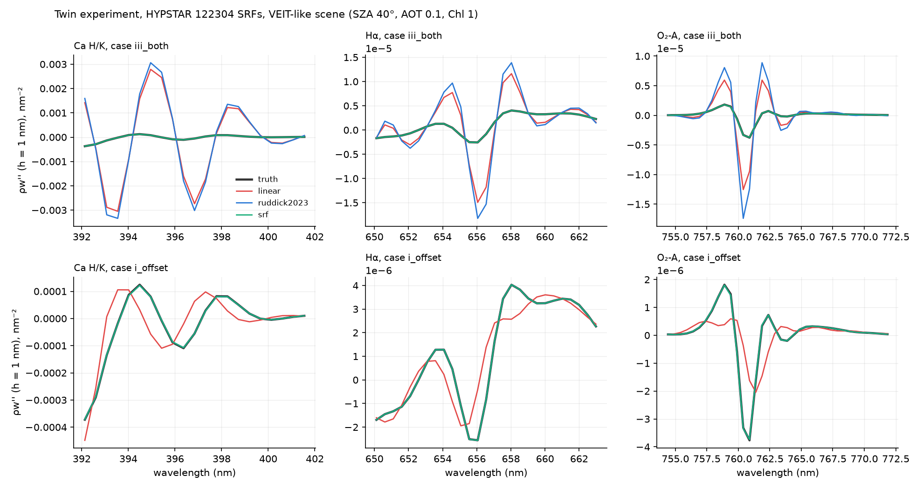
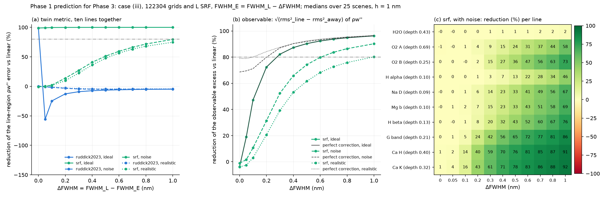
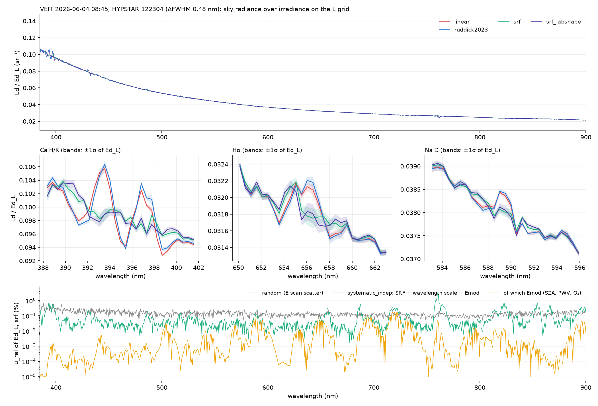
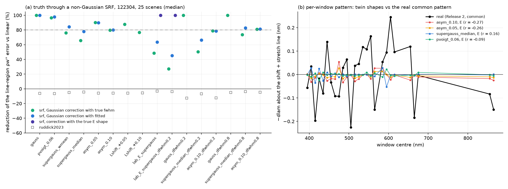

# Spectral wiggles in WATERHYPERNET ρw — interim report

**J. Xavier Prochaska (UC Santa Cruz) · 15 October 2026**

*For the HYPERNETS team.  This covers the work since our note of 28 September
2026, done on Kevin's VEIT sample, the Release 2 L2 archive and simulations.
The requested L1A data have not yet arrived; everything that depends on them is
marked provisional.*

---

## 1. Summary

- **The wiggles are real, and the main cause on some instruments is not the
  one we started from.**  On three of the seven HYPSTARs we examined (122302,
  122304, 120242), the irradiance channel E sees the solar lines through a
  spectral response function (SRF) about **0.5 nm narrower** than the radiance
  channel L.  No interpolation of E onto the L grid can remove that mismatch.
  On the other four (121222, 121231, 122303, 122305), E and L agree to within
  0.07 nm at 450 nm; 122303 is borderline (0.14 nm over 400-680 nm).
- **A one-symbol change to eq. (14) of Ruddick et al. (2023) fixes it.**
  Evaluate the model irradiance with the **L** SRF in the numerator (the
  `srf` method).  In simulation it removes ~100 % of the line-region error in
  ρw'' on a narrow-E instrument, where eq. (14) removes none.  On the real
  VEIT sample it cuts the line structure in Ld/Ed by ~4× at Ca H/K.
- **The code is ready to drop in.**  A `punpy` measurement function for
  `hypernets_processor` uses `srf` where E is ≥ 0.15 nm narrower than L, and
  linear interpolation elsewhere.  Left unwired, it reproduces today's linear
  interpolation exactly.
- **What we need from you** (Section 5): the L1A data and calibration files
  from our request, any laboratory slit-function and wavelength-calibration
  data, a few hardware and processor facts, and RBINS's view on integrating
  the snippet.

## 2. Goals

Kevin's hypothesis (Ruddick et al. 2023) is that ρw = π Lw / Ed acquires
spurious structure at the Fraunhofer and telluric lines because the processor
linearly interpolates E onto the L wavelength grid.  That structure dominates
ρw'', the quantity that pigment-detection algorithms use.  We set out to:

1. **diagnose** the wiggles: measure the E and L SRFs and wavelength scales
   from the solar lines themselves, and test two hypotheses:
   - **H1:** grid offset + linear interpolation (Kevin's);
   - **H2:** an E-vs-L SRF-width mismatch (ours, from the VEIT sample);
2. **predict**, with a simulation where the truth is known, which correction
   removes which wiggle, and what it does to real spectral features;
3. **deliver** a tested correction, with uncertainties in the processor's
   conventions, as a drop-in for `hypernets_processor`;
4. **verify** it on real sequences across sites and instruments, and write a
   technical note.

The plan has four phases with explicit gates (G0-G3); Phases 1 and 2 are done.

## 3. Work to date

### 3.1 Phase 0: what the data say (VEIT sample and the Release 2 archive)

We fit Gaussian SRFs against the TSIS-1 solar spectrum (HSRS) in 10 nm
windows, separately for E, Ld and Lu.  On the VEIT sample (HYPSTAR 122304)
E is ~2.2-2.4 nm wide and Ld/Lu ~2.6-2.9 nm (Figure 1).  The wavelength scale
is air, within 0.1 nm.

*Figure 1.  VEIT 2026-06-04, HYPSTAR 122304.  Top: SRF FWHM of E, Ld and Lu
from template fits to TSIS-1 HSRS.  Middle: L − E, ~0.5 nm in the blue.
Bottom: centroid offsets against HSRS in air (the dotted line is what a
vacuum scale would give).*

Repeating this on the 224 sequences of our data request, read from their
Release 2 L2B files, gives two instrument classes (Figure 2, Table 1).  The
SRFs are stable to 0.01-0.06 nm within each instrument and calibration
period, across SZA 21-74°, seasons, sites and recalibration.

*Figure 2.  Release 2 L2B, 224 sequences: SRF FWHM at 450 and 600 nm by
instrument and calibration.  E (blue) is ~0.5 nm narrower than Ld (orange) on
120242, 122302 and 122304.*

**Table 1.  The two instrument classes.**  ΔFWHM = FWHM_Ld − FWHM_E (median
400-680 nm, from L2; E from L2 reads 0.06-0.09 nm too wide, see §5).

| instrument | site(s) | ΔFWHM (nm) | class | method we would ship |
|---|---|---:|---|---|
| 122302 | BEFR, THFR | 0.46 | narrow-E | `srf` |
| 122304 | VEIT | 0.39-0.49 | narrow-E | `srf` |
| 120242 | GAIT | 0.39 | narrow-E | `srf` |
| 122303 | MAFR | 0.14 | borderline | `linear` (to be confirmed with L1A) |
| 121231 | MAFR | 0.08 | E ≈ L | `linear` |
| 122305 | VEIT | 0.01 | E ≈ L | `linear` |
| 121222 | GAIT | −0.05 to −0.03 | E ≈ L | `linear` |

**ρw wiggles follow the class** (Figure 3).  At the lines, the ρw residual on
narrow-E instruments is 2-3× that of E ≈ L instruments at Ca H/K and the
G band, at about the size H2 predicts.  The excess is absent at Na D, where H2
is small.  The two same-site pairs show it too: VEIT 122304 vs 122305, and
GAIT 120242 vs 121222.  The E ≈ L instruments keep a smaller line residual of
0.5-2 % that H2 does not explain.

*Figure 3.  Release 2, 224 sequences: the ρw relative residual within ±5 nm
of the lines, by instrument (left), and against each sequence's own H2
prediction (right).*

### 3.2 Phase 1: a twin experiment

We built synthetic HYPSTAR scenes where the truth is known:

- a 0.01 nm irradiance (TSIS-1 HSRS × HITRAN O₂/H₂O × O₃) multiplied by
  smooth OSOAA radiative-transfer fields;
- 25 sky/water states, with chlorophyll fluorescence and water Raman as real
  features a correction must not erase;
- observed with the measured SRFs on the real pixel grids.

We then scored the three interpolation methods by the error in ρw'' near ten
solar and telluric lines.

*Figure 4.  Twin experiment, HYPSTAR 122304 SRFs: ρw'' at Ca H/K, Hα and
O₂-A for the truth and three methods.  Top: grid offset plus SRF mismatch.
Bottom: grid offset only.*

**Table 2.  Twin results (median over 25 scenes, h = 1 nm).**

| | linear | eq. 14 (`ruddick2023`) | `srf` |
|---|---|---|---|
| narrow-E (122304), offset + mismatch: reduction of the line-region ρw'' error vs linear | — | 0 % (−6 %) | **~100 %** |
| grid offset only (H1): its error relative to the mismatch error | 4 % | removes 99 % | removes 99 % |
| E ≈ L (122305): linear's error vs the true line structure | below it | 2.3× *worse* than linear | 99.5 %, but fragile |

- **H1 is small on these well-sampled spectra; H2 dominates.**
- **Gate G1 passed for narrow-E instruments.**  `srf` meets the > 80 % target,
  and eq. 14 alone does not.
- **What `srf` needs:**
  - the E wavelength scale known to ≤ 0.05 nm relative to the model, and the
    SRF widths to ≲ 0.07-0.1 nm;
  - the model irradiance's atmosphere matters little (≥ 98 % for SZA ± 10°,
    water vapour × 0.5-3).
- **No method damages the fluorescence or Raman features.**  `srf` restores
  them exactly, while linear distorts their ρw'' by 20-45 %.
- **Prediction for real data:** a 60-75 % reduction of the observable
  line-region excess per sequence at ΔFWHM 0.5 nm, and little below 0.1 nm
  (Figure 5).

*Figure 5.  The expected reduction against ΔFWHM.  (a) the twin metric; (b)
the observable excess that can be measured on real data without a truth;
(c) per line, with VEIT-level noise.*

### 3.3 Phase 2: code and a first check on real data

**Deliverables** (all in the `hypernet` package, 137 tests):

- `interpolate_ed_to_l`: linear, eq. 14 and `srf` on one code path.  With a
  flat model it is exactly `np.interp`; with equal SRFs it is exactly eq. 14.
- SRF self-calibration from a single spectrum, and a wavelength-scale fit
  (shift + stretch).
- A cached model irradiance per SZA bin.
- A per-instrument SRF table, provisional until the L1A delivery.
- Uncertainty propagation with `punpy` into the processor's three relative
  components.
- **`InterpolationWavSRF`**, a drop-in for `InterpolationWavLinear`
  (Section 4).

**On the VEIT sample** (Figure 6):

- linear interpolation reproduces your L1C irradiance to a median of
  1.3 × 10⁻⁵;
- `srf` reduces the line structure in Ld/Ed_L from 2.45× to 1.60× the
  away-from-lines level, and at Ca H/K from 0.034 to 0.009 rms;
- eq. 14 makes it slightly worse, as the twin predicted;
- the new uncertainty terms (SRF, wavelength scale, model) are ~0.04 %,
  below the 0.13 % measurement noise except inside the deep gas bands.

*Figure 6.  VEIT sample: Ld / Ed_L for the three methods, zooms with ±1σ
bands, and the uncertainty components of the `srf` result.*

**Robustness** (Figure 7):

- the gain survives a pseudo-Voigt SRF (97-98 %) and an asymmetric one
  (80-90 %);
- with the flat-topped shapes our Phase 0 fits allow, it drops to 66-84 %.
  This is the main residual risk.

*Figure 7.  (a) The `srf` reduction when the true SRF is not Gaussian but the
correction is.  (b) The per-window wavelength pattern produced by SRF shape,
compared with the pattern seen on every real HYPSTAR (black).*

**Two findings we cannot yet explain:**

- **A 0.13 nm per-window wavelength pattern, the same on all seven
  instruments and in both channels.**  Spectrometers with different pixel
  grids cannot share a dispersion error, so it is not instrumental in the
  usual sense.
  - It is not SRF shape, and not the solar reference (HSRS agrees with
    Kurucz 2005 to < 0.01 nm in 24 of 27 windows).
  - Weak telluric lines explain part of it in simulation, but not on the
    real data.
  - We remove it empirically for now.
- **The wavelength scale itself has a stretch.**  After removing that
  pattern, E's scale error reaches ~0.1 nm at the ends of the spectrum,
  above the 0.05 nm `srf` needs.  The code corrects it per sequence (or per
  calibration period).

## 4. What comes next

| step | what | needs |
|---|---|---|
| Phase 0b → gate G0 | Refit E and L on L1A with the true E grids and per-pixel errors; confirm the instrument classes and SRF stability; settle 122303 and 121231 | **the L1A delivery** |
| SRF table | Rebuild it from L1A (replacing the provisional L2 rows) | Phase 0b |
| Phase 3 → gate G3 | Apply the three methods to every requested sequence; compare the reduction of the line-region ρw'' excess with the Phase 1 prediction (60-75 % on narrow-E instruments); check that fluorescence and pure-water features are unchanged | L1A delivery, ancillary water vapour |
| Open items | The common window pattern; the 936 nm water band (needs per-sequence water vapour); extending the model irradiance to 350-1100 nm | — |
| Technical note | Diagnosis, twin results, in-situ before/after, uncertainty budget; code hand-over | G3 |

## 5. What we need from the HYPERNETS team

1. **The L1A delivery in our request** (`docs/wiggles_data_request.csv`, sent
   28 September 2026).
   - **Products:** L1A_IRR, L1A_RAD, L1C_ALL and L2A_REF for the 150 primary
     sequences, with spares where a primary is unsuitable.
   - **Coverage:** five sites and seven instruments.  If 150 is too many, the
     three GAIT rows can go first.
   - **Calibration files:** `HYPERNETS_CAL_HYPSTAR_<id>_{RAD,IRR}_v2.3.nc`
     for the seven instruments, with both versions for 122304 and 121222.
     The `instrument_calibration_file_rad` attribute points to the IRR file
     in the sample, so we would welcome the RAD file names.

   Everything marked provisional above waits on this.
2. **Laboratory slit-function (line-spread) and wavelength-calibration
   data**, if they exist:
   - lamp lines, dispersion polynomials, per-channel bandwidth measurements;
   - the files carry a flat 3.0 nm `bandwidth`.

   This is the most direct way to settle three things: the E/L width
   difference, the SRF shape (the flat-top risk in Figure 7a), and the common
   window pattern.
3. **What differs in hardware between the narrow-E instruments (122302,
   122304, 120242) and the others.**  In the irradiance fore-optics, diffuser,
   fibre or slit configuration?  It is not instrument age; the serial numbers
   split both ways.
4. **Stray-light or out-of-band characterisation** of the HYPSTAR
   spectrometer, if any.  Something common to every unit is our leading
   remaining candidate for the 0.13 nm window pattern.
5. **The processor:**
   - **The code version that produced Release 2.**  The public
     `hypernets_processor` (`main` = `9a12819a`, March 2026) is not current
     with it.  We wrote the snippet against that commit.
   - **Is `mcsteps = 0` intended for the water network?**  With it, no
     uncertainty propagates through the interpolation step, and the L1C
     `u_rel_*` irradiance values are all zero.
   - **`InterpolationWavClearSky`** is an eq.-14-style interpolator with a
     3 nm placeholder SRF.  As written it returns values on the irradiance
     pixels and never uses the radiance wavelengths.  Was it ever run on water
     data?
   - **Integrating `InterpolationWavSRF`.**  It needs one factory entry, the
     config value, and `system_id` and the acquisition date passed to its
     `setup` call (details in the module docstring).  Would RBINS be willing
     to wire and test it?
6. **A per-sequence water-vapour column** (e.g. the ancillary data the
   processor already retrieves), so the model irradiance can follow the 936 nm
   band.
7. **Confirmation that the HYPSTAR wavelength scale is air**, which the data
   indicate on every instrument.

---

*Code and tables: the `hypernet` repository (`hypernet/edinterp.py`,
`srfcal.py`, `srftable.py`, `emod.py`, `snippets/interpolate_wav_srf.py`;
results in `hypernet/wiggles/`).  The full plan is
`docs/wiggles_planning.md`.*
